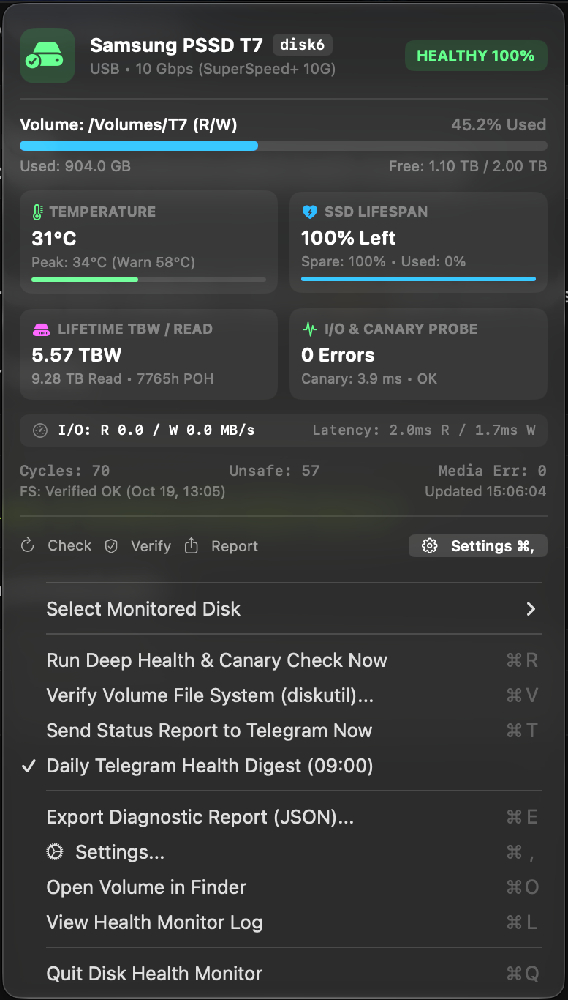
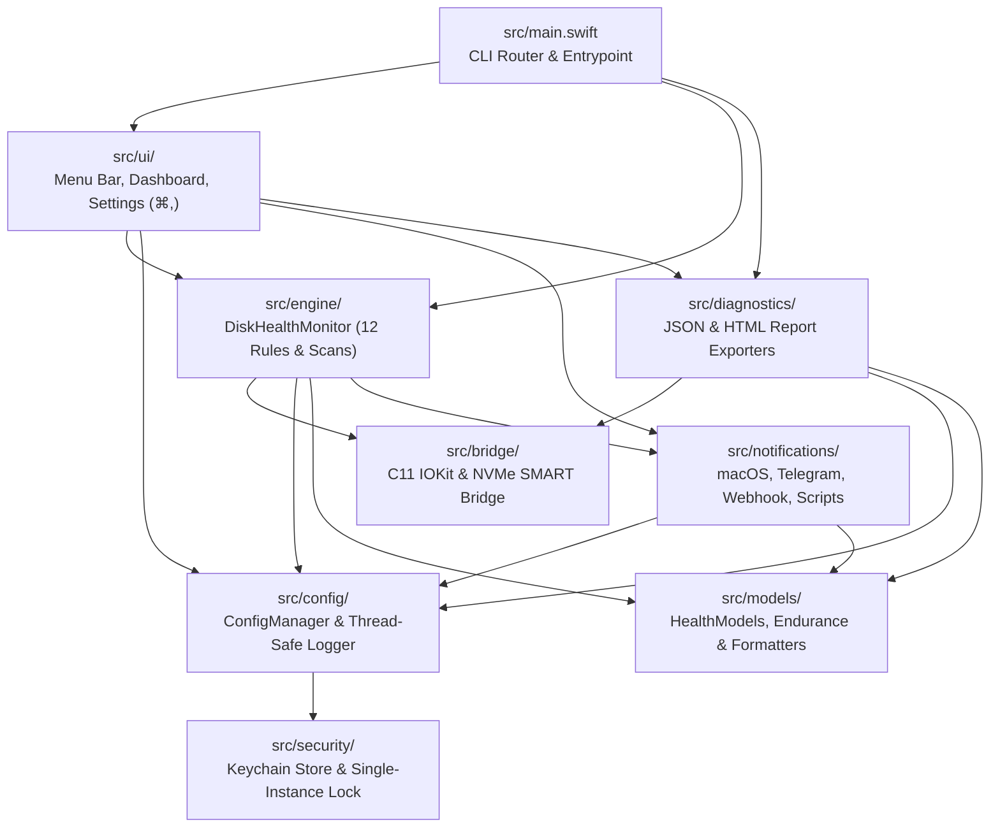

# Universal Disk Health Monitor

[](https://github.com/nikoskoutr/disk-health-monitor/actions/workflows/ci-release.yml)
[](https://github.com/nikoskoutr/disk-health-monitor/releases)
[](https://apple.com/macos)
[](https://github.com/nikoskoutr/disk-health-monitor/releases)
[](LICENSE)
[](https://swift.org)

A zero-dependency, high-performance macOS hardware telemetry daemon, menu bar monitor, and CLI utility for internal Apple Silicon / Intel SSDs and external USB, Thunderbolt, NVMe, and SATA storage devices.

Directly built on **IOKit**, **DiskArbitration**, **CoreFoundation**, and **Security.framework**, the engine queries hardware S.M.A.R.T. registers, physical link speeds, APFS purgeable space, kernel I/O error counters, and filesystem integrity in real time—requiring no third-party daemons, drivers, or kernel extensions.

<p align="center">
  
</p>

---

## Key Features

- **Zero-Dependency Native IOKit & C11 NVMe Bridge**: Direct kernel communication via `IONVMeSMARTUserClient` and `IOBlockStorageDriver`. Decodes full 128-bit little-endian NVMe counters without integer truncation.
- **Declarative Rule-Based Automation Engine (`⌘A`)**: `"When [Trigger] on [Drive Scope] for [Consecutive Polls] → Do [Action]"` automation engine supporting 13 trigger metrics (26 issue codes, numeric thresholds, severity transitions, and rate-of-change triggers), 6 drive scopes, poll hysteresis, per-rule cooldowns, boot-volume safety guards, dry-run simulation, 5 curated presets, and 12 automated actions (safe unmount/eject, read-only remount, Time Machine backup, APFS snapshot thinning, surface scans, Shortcuts, custom scripts, and top I/O process capture).
- **Process Disk I/O Culprit Detector (`--top-io`)**: Kernel-level `<libproc.h>` (`proc_pid_rusage` `RUSAGE_INFO_V4`) process I/O sampler that identifies and ranks the top processes generating disk read/write throughput during latency spikes or high write burn.
- **Historical Telemetry Ring Buffer & Trend Sparklines (`⌘S`)**: Persistent 180-point ring buffer (`history.json`) tracking temperature, free space, health score, latency, and cumulative TBW with native SwiftUI sparklines and rate-of-change calculations (`GB/hr` free space drop and `24h TBW`).
- **Hardware S.M.A.R.T. & Bus Power Inspector (`⌘I`)**: Detailed inspector displaying all raw NVMe registers, normalized attributes, critical warning bitmasks, USB bus power allocation (`mA`), and PCIe/Thunderbolt lane width (`x4`).
- **SSD Lifetime & Endurance Forecasting**: Real-time projection of remaining SSD operational lifespan and daily write burn rate ($\text{TB/day}$) derived from Power-On Hours (POH) and cumulative Terabytes Written (TBW).
- **Multi-Tier Physical Surface Scans**: Non-destructive direct unbuffered media read testing (`F_NOCACHE`) with 3 operational tiers (`quick`, `standard`, `full`), live terminal progress bar, throughput monitoring, error accounting, and cancellation.
- **APFS Physical Store Resolution & Purgeable Space Accounting**: Recursively traverses the `kIOServicePlane` registry tree from synthesized APFS volumes (`diskXsY`) to underlying physical block devices, distinguishing between nominal free space and opportunistic APFS purgeable capacity.
- **Active Canary Filesystem Probe**: Periodic non-destructive write, `fsync(2)`, read-back verification, and unlink checks detecting silent read-only transitions or stalled controller queues before metadata corruption occurs.
- **Scheduled Volume Verification**: Background filesystem integrity checking via `diskutil verifyVolume` with privilege classification (preventing false alerts on unprivileged runs), 180s watchdog, and configurable execution intervals.
- **Multi-Platform Alerting & Webhooks**: Transition-aware notifications (`HEALTHY` ↔ `WARNING` ↔ `CRITICAL`) with per-drive cooldowns via macOS Notification Center, audible critical beeps, custom shell scripts, Telegram Bot API, and universal webhooks (Discord, Slack, Mattermost, Home Assistant).
- **Standalone HTML Health & RMA Reports (`⌘H`)**: Generates self-contained, responsive HTML diagnostic reports ready for offline inspection, browser viewing, or hardware RMA warranty submissions.
- **POSIX Single-Instance Locking**: Non-blocking `flock(2)` with `O_NOFOLLOW | O_CLOEXEC` preventing duplicate menu bar instances while allowing unrestricted concurrent headless CLI executions.
- **macOS Keychain Credential Security**: Notification tokens stored securely in `Security.framework` Keychain with automatic restricted `0600` file fallback for headless SSH sessions.

---

## System Architecture

> [!TIP]
> For the comprehensive architectural specification including arc42 sections, C4 Model-as-Code diagrams, runtime sequence diagrams, lock hierarchies, and ADRs, consult the [System Architecture Specification](ARCHITECTURE.md).

```text
disk-health-monitor/
├── build_and_install.sh          # Build, test, packaging, and LaunchAgent installer script
├── .env.example                  # Template environment variable configuration
├── assets/                       # AppIcon.png (1024x1024), AppIcon.icns, and UI previews
├── scripts/                      # CoreGraphics vector icon generator
├── logs/                         # Runtime logs, latest JSON telemetry snapshot, and state persistence
├── tests/                        # C11/IOKit unit tests (17) and Swift engine unit tests (52)
└── src/                          # Modular C11 + Swift source tree
    ├── main.swift                # CLI router, argument parser, and NSApplication bootstrap
    ├── bridge/                   # Low-level C11 IOKit / NVMe SMART & libproc bridge
    ├── models/                   # Domain models, automation rule schemas, and POSIX formatters
    ├── security/                 # Keychain SecretStore and POSIX SingleInstanceLock
    ├── config/                   # ConfigManager, .env parser, and thread-safe logger
    ├── notifications/            # Notification Center, Telegram, Webhook, and Script dispatchers
    ├── diagnostics/              # JSON/HTML report exporters and ProcessIoInspector
    ├── engine/                   # 12-rule health engine, ActionRuleEngine, TelemetryHistoryStore, canary & scanner
    └── ui/                       # Menu bar controller, dashboard card, and 7-tab Settings window
```



### Module Documentation Index

| Directory | Scope |
| :--- | :--- |
| [`src/`](src/README.md) | Source architecture, compilation pipeline, and module dependencies |
| [`src/bridge/`](src/bridge/README.md) | C11 IOKit registry traversal, APFS physical store resolution, NVMe SMART interface |
| [`src/models/`](src/models/README.md) | Domain models, SSD endurance & burn rate projections, synchronized formatters |
| [`src/security/`](src/security/README.md) | macOS Keychain secret storage and POSIX single-instance lock |
| [`src/config/`](src/config/README.md) | Multi-source configuration resolution, `.env` parser, and structured logging |
| [`src/notifications/`](src/notifications/README.md) | Notification Center, Telegram Bot, Webhooks (Discord/Slack/HA), and script hooks |
| [`src/diagnostics/`](src/diagnostics/README.md) | Sanitized JSON diagnostic exporter, HTML RMA report generator, and `ProcessIoInspector` |
| [`src/engine/`](src/engine/README.md) | 12-rule evaluation engine, `ActionRuleEngine`, `TelemetryHistoryStore`, canary I/O probe, surface scanner |
| [`src/ui/`](src/ui/README.md) | Menu bar status controller, telemetry card, and 7-tab Settings window (`⌘,`, `⌘A`, `⌘I`, `⌘S`) |
| [`tests/`](tests/run_tests.sh) | 17 C11/IOKit unit tests, 52 Swift engine unit tests, and CLI test stages |
| [`scripts/`](scripts/generate_app_icon.swift) | CoreGraphics vector application icon generator |
| [`assets/`](assets/README.md) | Application branding and icon assets |
| [`logs/`](logs/README.md) | Runtime log files, telemetry snapshots, and state persistence |

---

## 12-Point Health Evaluation Engine

Each polling cycle evaluates a `DiskHealthSnapshot` against 12 deterministic rules:

| # | Rule Category | Telemetry Source | Trigger Condition | Severity |
| :--- | :--- | :--- | :--- | :--- |
| **1** | **Mount & Subpaths** | `statfs(2)`, `FileManager` | Target volume unmounted, device missing, or required subpaths absent | `CRITICAL` |
| **2** | **Hardware S.M.A.R.T.** | `IONVMeSMARTUserClient` | SMART failure or Critical Warning bitmask `!= 0` | `CRITICAL` |
| **3** | **Available Spare** | NVMe SMART Log `02h` | Available spare `< 25%` (`WARNING`) or `<= threshold` / `< 10%` (`CRITICAL`) | `WARNING` / `CRITICAL` |
| **4** | **SSD Wear Level** | NVMe SMART Log `02h` | Wear percentage `>= 80%` (`WARNING`) or `>= 95%` (`CRITICAL`) | `WARNING` / `CRITICAL` |
| **5** | **Drive Temperature** | NVMe SMART Log `02h` | Temperature `>= tempWarningCelsius` or `>= tempCriticalCelsius` | `WARNING` / `CRITICAL` |
| **6** | **Host Thermal State** | `ProcessInfo.processInfo` | macOS host thermal state enters `.critical` | `WARNING` |
| **7** | **Media & Kernel Errors** | NVMe Log `02h` & Driver Stats | Delta in media errors, error log entries, driver read/write errors or retries | `WARNING` / `CRITICAL` |
| **8** | **I/O Latency Spikes** | `IOBlockStorageDriver` | Average read/write latency exceeds threshold (`> 50 ms` warn, `> 200 ms` crit) | `WARNING` / `CRITICAL` |
| **9** | **Bus Link Speed** | `IOUSBHostDevice` | External link negotiates below expected speed (e.g., USB 3.0 on USB 2.0 port) | `WARNING` |
| **10** | **Unsafe Shutdowns** | NVMe SMART Log `02h` | Unsafe shutdown counter incremented relative to persisted baseline | `WARNING` |
| **11** | **Capacity & Free Space** | `statfs(2)` | Usage `%` above ceiling or free space below warning/critical floor | `WARNING` / `CRITICAL` |
| **12** | **Canary & Verification** | Active Canary & `diskutil` | Read-only mount, canary probe failure, or filesystem metadata corruption | `WARNING` / `CRITICAL` |

### SSD Wear & Endurance Forecasting

For NVMe storage devices, remaining lifespan and wear rates are calculated as:

$$\text{Remaining Lifespan (\%)} = \max(0, 100 - \text{Percentage Used})$$

$$\text{Daily Burn Rate} = \frac{\text{Total TBW}}{\max(1, \text{POH} / 24)} \quad (\text{TB/day})$$

- Lifetime forecasts project operational longevity based on active write velocity and accumulated Power-On Hours.
- For external enclosures lacking NVMe pass-through (`smartValid = false`), health is tracked via rules 1, 6, 7, 8, 9, 11, and 12.

---

## Quick Start & Build

### Requirements
- **macOS 13.0 (Ventura)** or newer (`arm64` Apple Silicon or `x86_64` Intel).
- Xcode Command Line Tools (`xcode-select --install`).

### Build & Run

```bash
# Compile and create DiskHealthMonitor.app + ./disk-health CLI
./build_and_install.sh

# Run the automated test suite (17 C tests + 52 Swift tests + CLI integration)
./build_and_install.sh --test

# Cross-compile release DMGs, ZIPs, and standalone CLI binaries in dist/
./build_and_install.sh --package

# Install CLI binary into /usr/local/bin
./build_and_install.sh --install-cli

# Register background LaunchAgents (periodic daemon + mount watcher)
./build_and_install.sh --install-service

# Unload and remove background LaunchAgents
./build_and_install.sh --uninstall-service
```

---

## Command-Line Interface (CLI) Reference

```bash
./disk-health [FLAG] [OPTIONS]
```

| Flag | Description |
| :--- | :--- |
| `--status` | Print human-readable disk health summary and active issues |
| `--json` | Serialize complete telemetry snapshot as pretty-printed JSON |
| `--list-disks` | List all detected block devices, buses, and S.M.A.R.T. readiness |
| `--check` | Execute a single daemon check cycle (evaluates rules and sends alerts) |
| `--watch-mounts` | Run a check cycle triggered by a mount event (invoked by LaunchAgent) |
| `--deep` | Append `diskutil verifyVolume` filesystem verification to check cycle |
| `--surface-scan [mode]` | Run non-destructive unbuffered physical read scan (`quick`, `standard`, `full`) |
| `--verify` | Run immediate volume filesystem verification (`diskutil verifyVolume`) |
| `--export-html [path]` | Generate standalone responsive HTML health & RMA report |
| `--export-diagnostics [path]` | Export comprehensive JSON diagnostic bundle |
| `--export-config [path]` | Export current configuration as sanitized JSON (`--unmasked` for secrets) |
| `--import-config <path>` | Import and apply configuration profile from a JSON file |
| `--list-rules` | Print configured automation rules (`When → Do`) and recent execution audit log |
| `--simulate-rule [id\|index]` | Dry-run simulate an automation rule against a synthetic matching snapshot |
| `--top-io` | Sample and rank the top disk I/O processes over 1.2s via `<libproc.h>` |
| `--test-alert-script` | Test execution of the configured custom alert shell script |
| `--send-report` | Dispatch an on-demand HTML health report to Telegram |
| `--volume <path>` | Target a specific mount point (e.g., `--volume /` or `--volume /Volumes/SSD`) |
| `--device <query>` | Target a specific device BSD identifier (e.g., `disk4`), model, or serial |
| `--menubar` | Launch persistent menu bar status item application (default with no flags) |
| `--version`, `-v` | Display version and binary architecture |
| `--help`, `-h` | Display CLI usage manual |

### Exit Codes
- `0`: `HEALTHY` — All evaluated rules passed cleanly.
- `1`: `WARNING` — One or more warning thresholds exceeded; no critical risk.
- `2`: `CRITICAL` — Hardware SMART warning, unmounted target, I/O error, or critical threshold breached.

---

## Configuration Schema & Precedence

Parameters resolve in descending priority:
1. **CLI Flags** (`--volume`, `--device`, `--deep`)
2. **Process Environment Variables**
3. **Local `.env` File** (`$DISK_HEALTH_ENV_FILE`, `~/.config/disk-health-monitor/.env`, or `./.env`)
4. **JSON Configuration File** (`~/.config/disk-health-monitor/config.json`)
5. **Compiled Defaults**

### Configuration Reference

| JSON Key | Environment Variable | Type | Default | Description |
| :--- | :--- | :--- | :--- | :--- |
| `targetVolumePath` | `DISK_HEALTH_VOLUME` | `String` | `""` (Auto) | Explicit mount point to monitor (empty auto-selects primary external or `/`) |
| `targetDeviceQuery` | `DISK_HEALTH_DEVICE` | `String` | `""` | Target device match by BSD name (`disk4`), model, or serial |
| `monitorAllDisks` | `MONITOR_ALL_DISKS` | `Bool` | `false` | Simultaneously monitor all connected internal and external physical drives |
| `monitoredTargets` | `DISK_HEALTH_TARGETS` | `[String]` | `[]` | Explicit list of mount points or BSD names to monitor in multi-disk mode |
| `useKeychainStorage` | — | `Bool` | `false` | Opt-in flag enabling macOS Keychain storage for interactive desktop sessions |
| `requiredSubpaths` | `DISK_HEALTH_REQUIRED_SUBPATHS` | `[String]` | `[]` | Comma-separated relative paths that must exist on mounted target |
| `enableActiveCanary` | `ENABLE_ACTIVE_CANARY` | `Bool` | `true` | Periodic write, `fsync()`, read-back, and unlink probe |
| `pollIntervalSeconds` | `POLL_INTERVAL_SECONDS` | `Double` | `30.0` | Background polling interval in seconds (`10`–`3600`) |
| `alertCooldownSeconds` | `ALERT_COOLDOWN_SECONDS` | `Double` | `3600.0` | Cooldown window (seconds) before repeating an identical alert |
| `tempWarningCelsius` | `TEMP_WARNING_CELSIUS` | `Int` | `58` | Temperature warning threshold (`°C`) |
| `tempCriticalCelsius` | `TEMP_CRITICAL_CELSIUS` | `Int` | `68` | Temperature critical threshold (`°C`) |
| `diskUsedWarningPercent` | `DISK_USED_WARNING_PERCENT` | `Double` | `85.0` | Volume capacity warning threshold (`%`) |
| `diskUsedCriticalPercent` | `DISK_USED_CRITICAL_PERCENT` | `Double` | `93.0` | Volume capacity critical threshold (`%`) |
| `minFreeSpaceWarningGB` | `MIN_FREE_SPACE_WARNING_GB` | `Double` | `30.0` | Minimum free space warning floor (`GB`) |
| `minFreeSpaceCriticalGB` | `MIN_FREE_SPACE_CRITICAL_GB` | `Double` | `15.0` | Minimum free space critical floor (`GB`) |
| `minExpectedUsbSpeedBps` | `MIN_EXPECTED_USB_SPEED_BPS` | `UInt64` | `5000000000` | Minimum expected USB link speed (`5000000000` = 5 Gbps USB 3.0) |
| `enableNativeNotifications`| `ENABLE_NATIVE_NOTIFICATIONS`| `Bool` | `true` | Native macOS Notification Center alerts |
| `enableCriticalSoundAlert` | `ENABLE_CRITICAL_SOUND_ALERT` | `Bool` | `false` | System audio beep on critical health transitions |
| `scheduledVerifyIntervalHours` | `SCHEDULED_VERIFY_INTERVAL_HOURS` | `Int` | `0` (Off) | Periodic `diskutil verifyVolume` interval (`0`, `6`, `12`, `24`, `48`, `168`) |
| `telegramBotToken` | `TELEGRAM_BOT_TOKEN` | `String` | `""` | Telegram Bot token (persisted in Keychain, redacted in config) |
| `telegramChatId` | `TELEGRAM_CHAT_ID` | `String` | `""` | Target Telegram chat or channel ID |
| `webhookUrl` | `WEBHOOK_URL` | `String` | `""` | Universal webhook URL (Discord, Slack, Mattermost, Home Assistant) |
| `alertScriptPath` | `ALERT_SCRIPT_PATH` | `String` | `""` | Executable shell script hook invoked on alerts |

---

## Credential Security & Headless Support

- **macOS Keychain Integration**: Sensitive tokens (`telegramBotToken`, `webhookUrl`) are stored in the macOS Keychain (`Security.framework`, service `io.github.disk-health-monitor`). On-disk `config.json` stores `"REDACTED_IN_KEYCHAIN"`.
- **Headless & SSH Fallback**: When running headlessly over SSH where the Keychain is inaccessible, `SecretStore` automatically falls back to `~/.config/disk-health-monitor/.secrets.json` enforced with POSIX `0600` (`rw-------`) permissions, or reads credentials directly from environment variables or `.env`.

---

## License

Released under the [MIT License](LICENSE).
