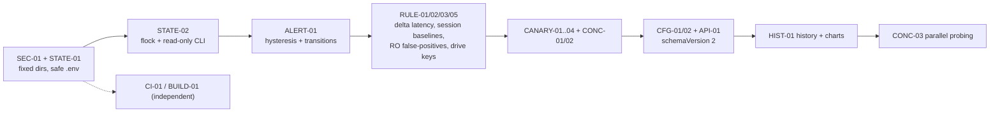

# Disk Health Monitor — Review, Opinion & Actionable Roadmap

> [!NOTE]
> This file replaces an earlier draft of the same name that was too flattering and left out most of the defects below. Every finding here points to a specific location in the code.

## 0. TL;DR for an LLM agent

1. Fix the **P0s** in §3 in order (SEC-01, STATE-01, STATE-02, ALERT-01, RULE-01). Each one is self-contained.
2. Do not trust test or feature counts in `README.md` / `ARCHITECTURE.md`. Several claims there don't match the code (§6).
3. Constraints to keep: zero third-party deps, a single binary built by `build_and_install.sh` (no SwiftPM), macOS 13+.
4. Run `./build_and_install.sh --test` after every change. Add a regression test for each fix (tests are in `tests/test_core_logic.swift`, numbered `Swift Unit Test N`).

## 1. Overall opinion

**Strengths (keep these):**
- The layering is good: a C11 IOKit bridge → Swift models/config → engine with pure `HealthRule` structs → AppKit/SwiftUI + CLI. Rules take a `HealthEvaluationContext` and return a value, which makes them easy to test.
- The C bridge is careful: balanced `IOObjectRelease`/`CFRelease`, 128-bit NVMe counter saturation, APFS subtree pruning so APFS volumes don't hijack the physical BSD name, and a live BSD-name refresh after a replug.
- There are no dependencies and the binary works in two modes (CLI + menu bar). Atomic 0600 writes with `O_NOFOLLOW` are used throughout.
- The feature set is genuinely useful: NVMe SMART without kexts or smartmontools, canary probes, Telegram/webhook/script alerts, and HTML RMA reports.

**Weaknesses (summary):**
- **Detection quality:** some rules measure the wrong thing (the latency rule uses a lifetime average), some never re-arm (driver-error baselines), and some fire on normal setups (NTFS / DMG mounts, Apple SSD error-log counts).
- **Alerting:** there is no hysteresis, so a value hovering near a threshold produces alert/recovery storms. A permanent warning re-alerts every hour forever.
- **State and config location depend on the current working directory**, and several processes write `state.json` without coordination.
- **The security model is weaker than documented:** loading `.env` from the cwd allows arbitrary script execution, and "Keychain" mode still keeps a plaintext copy of the secret.
- **Main-thread blocking** contradicts the documented invariant: SwiftUI view bodies and menu callbacks take `engineLock` and run IOKit enumeration on the main thread.
- **Documentation drift and inflated self-assessment.** `ARCHITECTURE.md` "Lead Architect sign-off", wrong counts, and features that don't exist.
- **No history:** the "Statistics & Insights" tab only shows the current snapshot.

**Score (honest):** architecture 8/10, C bridge 8/10, rule correctness 5/10, alerting UX 5/10, security 5/10, concurrency 6/10, tests 6/10, docs accuracy 4/10.

## 2. Repository facts (for orientation)

| Item | Value |
| :--- | :--- |
| Source size | ~15.4k lines (C 1.06k, Swift ~10k, tests 3k) |
| Build | `build_and_install.sh` → `clang` + `swiftc -import-objc-header`, `lipo` universal, ad-hoc `codesign` |
| Entry | `src/main.swift` (hand-rolled argv parsing; unknown flags fall through to the GUI) |
| Engine | `DiskHealthMonitor.shared` singleton, one `NSRecursiveLock engineLock` |
| Rules | 12 structs in `src/engine/HealthRules.swift`, run by `StandardHealthRulePipeline.defaultRules` |
| Persisted | `config.json`, `.secrets.json` (configDir); `state.json`, `latest_status.json`, `health.log` (logsDir) |
| Tests | `tests/test_disk_health_bridge.c`, `tests/test_core_logic.swift` (one big program, 39+ numbered blocks, not XCTest) |
| `docs/` | **listed in `.gitignore`**, so this file is not version-controlled unless it is un-ignored |

## 3. Findings

### P0 — fix first

#### SEC-01 · `.env` and logs are resolved from the current working directory (code execution + data exfiltration)
- **Files:** `src/config/ConfigManager.swift` `loadDotEnvWithWebhook` (searches `"\(currentDir)/.env"`, `"\(bundleDir)/.env"`) and `init` logsDir resolution (`"\(currentDir)/logs"` is used whenever that folder exists).
- **Evidence:** `ALERT_SCRIPT_PATH`, `WEBHOOK_URL`, and `TELEGRAM_*` are all honored from a cwd `.env`.
- **Impact:** Running `disk-health --check` inside an untrusted repo (one with a `.env` and `ALERT_SCRIPT_PATH=./x.sh`) executes that script on the next alert. A `.env` belonging to another project can redirect disk telemetry, including serial numbers, to its `WEBHOOK_URL`.
- **Fix:** Only load `$DISK_HEALTH_ENV_FILE` and `\(configDir)/.env`. Drop the cwd and bundle-parent lookups, or put them behind `DISK_HEALTH_DEV=1`. Refuse an env file that isn't owned by the current uid or that is group/world-writable (`stat` + `st_mode & 0o022`). Apply the same ownership and permission check to `alertScriptPath`.
- **Acceptance:** A test creates a temp cwd containing a `.env` with `ALERT_SCRIPT_PATH` and asserts that `resolvedAlertScriptPath` stays empty.

#### STATE-01 · `state.json` / `latest_status.json` location depends on the cwd
- **Files:** `ConfigManager.init` (logsDir), `ConfigManager.stateFilePath = logsDir/state.json`.
- **Impact:** The CLI run from the repo, the CLI run from `~`, the LaunchAgent (`WorkingDirectory = logsDir`), and the menu bar app can each use a different `state.json`. Baselines, alert cooldowns, and verify history then split or reset at random. State is not a log file.
- **Fix:** Use a fixed `stateDir = configDir` (or `~/Library/Application Support/DiskHealthMonitor`). Keep `logsDir` overridable only through `DISK_HEALTH_LOGS_DIR`. Add a one-time migration that picks the newest existing `state.json`.
- **Acceptance:** `stateFilePath` is identical when computed from two different cwds.

#### STATE-02 · Several processes read-modify-write `state.json` with no inter-process lock
- **Files:** `DiskHealthMonitor.loadState/saveStateLocked`. Writers: the menu bar app, LaunchAgent `--check` / `--watch-mounts`, and any manual CLI run.
- **Impact:** Lost updates. A cooldown timestamp written by one process is overwritten by another's stale copy, which causes duplicate alerts or missed baseline advances. `--status` (meant to be read-only) also writes state and `latest_status.json`.
- **Fix:** (a) Reload, merge, and write under `flock(stateDir/state.lock, LOCK_EX)` in `saveStateLocked`. (b) Make `--status` / `--json` / exports non-mutating (add a `persist: Bool` parameter to `evaluateAllMonitoredDisks`). (c) Document one process as the alert owner: when the menu bar lock (`menubar.lock`) is held, CLI `--check` should skip notifications.
- **Acceptance:** Two concurrent `--check` loops (100 iterations each) keep every cooldown key and never decode an empty or partial file.

#### ALERT-01 · No hysteresis: flapping issues cause alert/recovery storms; persistent issues re-alert hourly
- **File:** `DiskHealthMonitor.processAlertsAndDigestLocked`.
- **Evidence:** On recovery, every `driveKey:*` cooldown key is deleted. Any issue whose cooldown has expired re-sends *all* issues. A severity change under the same code (e.g. `TEMP_WARNING` → `TEMP_CRITICAL` uses different codes, but `IO_LATENCY_*` would be suppressed by cooldown) isn't treated as an escalation.
- **Impact:** A temperature hovering around 58°C produces a WARNING alert and then a RECOVERED message every 30 s poll. A disk at 86% full generates a notification and a Telegram message every hour indefinitely.
- **Fix:**
  - Require N consecutive polls before entering or leaving a state (default 2), plus value hysteresis (temperature: clear at `warn - 3°C`; space: clear at `warn - 2%`).
  - Alert on **transitions** (new code, or a severity increase). Re-notify persistent issues with exponential backoff (1h, 4h, 24h, then daily), configurable as `reminderSchedule`.
  - Keep cooldown keys through recovery for a `recoveryHoldSeconds` window (default 15 min).
  - Send only new or changed issues in the alert body, and list the rest as "still active".
- **Acceptance:** In a synthetic sequence of temperatures 57,59,57,59 over 8 polls, at most 1 alert and 0 recoveries are sent.

#### RULE-01 · The "I/O latency spike" rule uses a lifetime average, so it can't detect spikes
- **Files:** `DiskHealthMonitor.evaluateSingleTargetLocked` (`avgReadLatMs = totalTimeReadNs / operationsRead`), `DriverStatsAndLatencyRule`.
- **Impact:** The counters are cumulative since the device attached. After days of uptime, a 10-minute stall barely moves the average. Meanwhile a USB HDD that was slow at spin-up stays above 50 ms for the whole session.
- **Fix:** Store the previous `(ops, totalTimeNs)` per driveKey next to `throughputSamplesByDrive`. Compute interval latency `Δtime/Δops` only when `Δops >= 50`. Keep the lifetime average as an informational field. Make the thresholds configurable (`ioLatencyWarnMs`, `ioLatencyCritMs`), with separate defaults for SSD vs HDD (`isRotational` from `Device Characteristics → Medium Type`).
- **Acceptance:** A mock with a lifetime average of 5 ms plus an interval of 400 ms produces `IO_LATENCY_CRITICAL`; a lifetime average of 80 ms with an interval of 2 ms produces no issue.

### P1 — wrong results / false positives

| ID | Files | Problem | Fix |
| :--- | :--- | :--- | :--- |
| RULE-02 | `HealthRules.swift` `DriverStatsAndLatencyRule`; `DiskHealthMonitor` baseline init | `baselineIoReadErrors/WriteErrors` start at 0 and only `resetBaselines()` advances them. One historical USB hiccup keeps a drive **CRITICAL forever**. Driver counters reset at reboot/replug while baselines persist, so after a reset, new errors below the old baseline go unnoticed. | Make baselines **session-aware**: store `kern.boottime` + IORegistry entryID with each baseline, and re-baseline when the counter decreases or the session changes. Alert on *delta per session*, and auto-advance after an alert is delivered (same as retries). |
| RULE-03 | `VolumeMountAndReadOnlyRule` | Every read-only mount other than `/` is CRITICAL. NTFS drives (read-only natively on macOS), mounted DMG/ISO, and camera cards with the lock switch on are all false CRITICALs. | Only flag `VOLUME_READONLY` when the volume was **previously RW** (track `wasWritable` in drive state) or the fs type is apfs/hfs/exfat and the mount flags changed. Skip `ntfs`, `cd9660`, `udf`, and disk images (`AppleDiskImageDevice` parent). |
| RULE-04 | `DiskListAllDevices` + `evaluateAllMonitoredDisks` | `monitorAllDisks` covers every `IOBlockStorageDevice`, including disk images, empty card readers, and simulator runtimes. Canary probes write into all of them. | Filter virtual devices in C (parent class `AppleDiskImageDevice` / `IOHDIXHDDriveOutKernel`, or `Protocol Characteristics` `Virtual Interface`). Add a `excludedDevices` config (serial/BSD/model glob). |
| RULE-05 | `evaluateAllMonitoredDisks` dedup by serial | Two enclosures reporting the same or a dummy serial (`000000000000`, `0123456789ABCDEF`) collapse to one drive, and the second is **silently dropped**. The same serial also mixes their baselines. | Make the drive key `serial` only when it is non-trivial and unique within the current enumeration. Otherwise use `serial#bsd` or the registry entryID. Keep a deny-list of placeholder serials. |
| RULE-06 | `HostThermalAndVerifyRule` | Host thermal pressure is reported per drive, so N drives give N issues and N alerts. | Move host-level checks to a fleet-level issue on `MultiDiskHealthSnapshot.fleetIssues`. |
| RULE-07 | `SMARTIntegrityAndShutdownRule` `ERROR_LOG_INCREASED` | Apple internal SSDs bump `errorInfoLogEntries` routinely, which gives recurring warnings. The UI marks any nonzero value red. | Default `errorLogIncreaseIsWarning=false` for `isInternal && vendor==Apple`. Otherwise require Δ ≥ `errorLogDeltaThreshold` (default 10/day). |
| RULE-08 | `ThermalAndSpikeRule` + `ConfigManager` | Thresholds are global (58/68°C). NVMe drives report their own WCTEMP/CCTEMP in Identify Controller, and HDDs and NVMe have different safe ranges. Config values aren't validated (warn ≥ crit is allowed via env). | Read Identify Controller WCTEMP/CCTEMP when possible (fallback: config). Add per-drive overrides (`driveOverrides[serial]`). Add a `DiskHealthConfig.validated()` that clamps ranges and enforces warn < crit. |
| RULE-09 | `DiskHardwareMetrics.temperatureCelsius` / bridge | An invalid temperature returns `0` (the header says `-999`). 0 is a valid reading and isn't reported as "unknown". | Return `INT32_MIN` / set `temperatureValid=false`. In Swift, model it as `Int?`. |
| CANARY-01 | `DiskHealthMonitor` snapshot init; Dashboard / Stats / Telegram / HTML | With the canary **disabled**, `canaryOk=false` and `canaryError="Canary disabled"`. The dashboard tile turns red with "Canary: FAILED", and Telegram shows "❌ FAILED (Canary disabled)". | Model it as `enum CanaryStatus { disabled, suppressed, ok(latency), failed(reason) }`. |
| CANARY-02 | `CanaryProbeService.performSingleCanaryPass` | `fsync` on macOS doesn't flush the drive cache, so the readback can come from controller DRAM. 512 B writes are sub-block on 4K APFS (read-modify-write). The `Data` buffer isn't page-aligned. | Use `fcntl(F_FULLFSYNC)` (fall back to `fsync`), a 4096-byte page-aligned buffer (`posix_memalign`), and rename the claim from "physical media verification" to "write-path liveness". |
| CANARY-03 | same | The root probe uses the shared `/System/Volumes/Data/private/tmp`. Another user can pre-create `.disk_health_canary_<uid>` there; the sticky bit then makes `unlink` fail, the probe silently falls back to `readdir`, and reports `ok=true`. | Probe inside a per-user directory (`NSTemporaryDirectory()` / `~/Library/Caches/DiskHealthMonitor`) on the Data volume. Report `fallback=readdir` explicitly instead of a plain `ok`. |
| CANARY-04 | same | Writing every 5 min on every external volume keeps external HDDs from spinning down (power and wear), and leaves `.disk_health_canary_501` files on USB sticks and SD cards. | Make the canary per-volume opt-in for removable media. Skip it when `Medium Type == Rotational` unless enabled. Unlink after each probe on non-APFS volumes. |
| SCAN-01 | `SurfaceScannerService` | This isn't a surface scan. It reads the first ≤256 KB/2 MB of files in enumerator order, skips hidden files and free space, and pages already in the cache bypass `F_NOCACHE`. On `/` it triggers TCC prompts (Documents/Desktop/Removable Volumes). | Rename it to "File read sample" in the UI and docs. Randomize file selection. Add an optional privileged raw read of `/dev/rdiskN` (sudo CLI only) for a real LBA scan. Skip TCC-protected directories unless Full Disk Access has been granted. |
| VERIFY-01 | `VolumeVerifierService.classify…`, `DiskHealthMonitor.runVolumeVerification` | A timeout is classified as healthy "Skipped", although a hang on a dying drive is itself a signal. Scheduled verifies send Telegram "Verification Skipped" on every interval (unprivileged `-69863`). | Turn timeouts into `VERIFY_TIMEOUT` warnings. Don't notify on Skipped. If the result is always Skipped (unprivileged), disable the schedule and show "requires admin". |
| ENDUR-01 | `HealthModels.dailyTerabytesWritten`, `estimatedRemainingLifeFormatted` | Uses power-on hours as if they were calendar days. A laptop on 8 h/day shows 3× the real TB/day, and the "remaining life" isn't in calendar time. | Store `firstSeenTimestamp` + `firstSeenDataUnitsWritten` / `percentageUsed` per drive and compute a calendar-time burn rate once ≥7 days of data exist. Keep the POH-based value labeled "per powered-on day". |
| BRIDGE-01 | `DiskHealthBridge.c` `DiskListAllDevices` | When `count == maxCount`, `IOIteratorNext` has already returned a retained service that is never released (leak). | `while (count < maxCount && (service = IOIteratorNext(iter)))`. |
| BRIDGE-02 | `DiskHealthBridge.h` vs `.c` | The header documents USB speed codes 1→1.5 Mbps … 5→10 Gbps; the code maps 1→12M, 2→480M, 3→5G, 4→10G, 5→20G (matches the IOUSBHost enum). A generic `"Link Speed"` value of 1–5 from a non-USB parent (PCIe gen code) would be misread as a USB speed. | Fix the header. Only apply code mapping for the `"Device Speed"` key on USB classes. Treat `UsbLinkSpeed` as bps. |
| BRIDGE-03 | `DiskReadHardwareMetrics` auto mode | The doc says "NULL/auto queries `/`", but the code picks the first external device. Auto mode also opens the SMART plugin on **every** device just to choose one. | Align the doc. In auto mode, enumerate using only static properties and read SMART for the chosen device only. |

### P2 — robustness, performance, UX

| ID | Files | Problem | Fix |
| :--- | :--- | :--- | :--- |
| CONC-01 | `DashboardMenuView.body`, `StatisticsAndInsightsTab`, `AppDelegate.populateSelectDiskMenu/openVolumeInFinder/export*` | `monitor.currentMultiSnapshot` / `currentSnapshot` take `engineLock` **on the main thread** (including inside SwiftUI `body`). A poll that is blocked in `statfs`/`fsync` on a stalled USB drive freezes the menu. This contradicts ARCHITECTURE §8.1 "lock-free UI". | The UI reads only the `@Published` copies. Replace the internal fallbacks with `publishedMultiSnapshot ?? nil`. Add `assert(!Thread.isMainThread)` (debug) inside `engineLock` accessors. |
| CONC-02 | `AppDelegate.menuWillOpen` → `updateDiskCache()` | `listAllDevices(16)` (full IOKit walk + SMART plugin per device) runs synchronously on the main thread every time the menu opens. | Refresh the cache in the background on mount/unmount notifications and populate the menu from the cache only. |
| CONC-03 | `evaluateAllMonitoredDisks` | One lock is held across all drives, including canary `fsync`, `statfs`, and URL-session dispatch. One wedged drive stalls the whole fleet and the CLI. | Collect telemetry per drive concurrently (bounded to 4) **outside** the lock, with a per-drive timeout (3 s → `DRIVE_UNRESPONSIVE` warning). Take the lock only to merge state and swap snapshots. |
| CONC-04 | `SettingsViewModel.toggleLaunchAgent` | `signal(SIGTERM, SIG_IGN)` is process-wide and changed from a background queue. | Use `launchctl kickstart`/`bootout` with a label that differs from the running instance, or let the build script own the LaunchAgent. |
| NOTIF-01 | `main.swift` `waitForPendingNotifications(timeout: 3.0)` vs URLSession 15 s | CLI `--check` exits after 3 s and drops in-flight Telegram/webhook requests on slow networks. | Wait up to `timeoutIntervalForResource + 1`. Add a small persistent outbox (`outbox.jsonl`) retried on the next run. |
| NOTIF-02 | `TelegramNotifier`, `WebhookNotifier` | `connectionProxyDictionary = [:]` disables the system proxy, which breaks corporate networks. There's no 4096-char cap for Telegram. Serial numbers and hostname are sent to third parties. | Remove the proxy override. Truncate to 4000 chars. Add `redactSerialsInAlerts` (default true for webhook/Telegram). |
| NOTIF-03 | `processAlertsAndDigestLocked` daily digest | `lastDailySummaryDate` is global while the timestamp key is per drive, so the first drive initializes it and other drives send immediately. The digest is Telegram-only. | Key per drive consistently. Send one fleet digest message, optionally through the webhook too. |
| NOTIF-04 | `executeAlertScriptAsync` | Kills by PID only (children survive). Inherits the full environment. The test path uses `pkill -P`, so the two code paths behave differently. | Spawn with `posix_spawn` + `POSIX_SPAWN_SETPGROUP`, kill `-pgid`. Pass a minimal env plus `DISK_HEALTH_*` and a JSON snapshot on stdin. Use the same helper for diskutil (also fixes the PID-reuse issue in ARCHITECTURE §11.8). |
| SECR-01 | `SecretStore.setSecret` | In Keychain mode the secret is **always also written in plaintext** to `.secrets.json`, and reads prefer the file. Keychain adds no protection. The config shows `REDACTED_IN_KEYCHAIN` even when the secret is only in the file. | Pick one store per mode. Keychain mode: delete the file copy after a successful write and read from the in-memory cache, falling back to the Keychain non-interactively (`kSecUseAuthenticationUIFail`). Rename the placeholder to `"<stored-securely>"` and add `secretBackend` to config. |
| SECR-02 | `SecretStore` `isCustomConfigDirOverride` / `simulatedKeychainStatusForTesting`; `MockTelemetryProvider` | Test hooks ship in the production binary. A custom `DISK_HEALTH_CONFIG_DIR` makes Keychain "succeed" without storing anything. | Wrap them in `#if DEBUG` / `-D TESTING` and compile tests with that flag. |
| CFG-01 | `ConfigManager.updateConfig` | `_config` already merges `.env` and env overrides, and `updateConfig` persists it, so runtime overrides (e.g. `DISK_HEALTH_VOLUME`) leak into `config.json`. | Keep `persistedConfig` and `effectiveConfig` separate. Mutate and save only `persistedConfig`, then recompute effective. |
| CFG-02 | `DiskHealthConfig` | Three overlapping targeting models (`monitorAllDisks`, `monitoredTargets`, `targetVolumePath/targetDeviceQuery`) make UI checkmarks inconsistent. | `targetMode: .auto | .all | .list([TargetSpec])` plus a migration. Add `schemaVersion`. |
| CLI-01 | `main.swift` | Unknown or typoed flags launch the GUI. `--volume` + `--device` override each other. `args.contains` priority order is implicit. | Write a small declarative parser (still dependency-free): subcommand + options, reject unknown flags with exit 64, and add `--quiet` and `--no-exit-severity` for scripting. |
| API-01 | `latest_status.json` | The shape changes between `DiskHealthSnapshot` (1 disk) and `MultiDiskHealthSnapshot` (>1). There's no schema version. | Always write `{schemaVersion: 2, fleet: Multi…}`. Publish a JSON Schema in `docs/`. |
| UI-01 | `HealthIssue.id = code` | Duplicate codes (`REQUIRED_PATH_MISSING` for several paths) give duplicate SwiftUI `ForEach` IDs and rendering glitches. | `id = code + ":" + subject` (add a `subject` field). |
| UI-02 | `SettingsWindowController` | ADR-007 says the VM is torn down on close, but `private static let sharedVM` lives forever. Typing a token triggers a config save and a full health refresh 0.4 s later, with notifications enabled. | Create the VM per window. Debounce `ConfigManager` → refresh only on monitoring-relevant keys. |
| UI-03 | Dashboard / Stats colors | Hard-coded 82/92% capacity colors vs config 85/93. Spare is shown as "ok" when `> threshold`, which disagrees with the rule's `spareThresh <= 50` logic for Apple SSDs. | Derive all colors from the same rule thresholds (expose `ruleThresholds` on config). |
| LOG-01 | `logs/health.log` | Dark wake produces bursts of 4–8 identical "Ignoring dark-wake volume mount event" lines per second. `log()` does a stat + open + close per line, and rotation races across processes. | Dedupe repeated messages ("…repeated N times"), add log levels, and consider `os_log` (`Logger(subsystem:)`) plus a file sink for exports. |
| PERF-01 | `inspectFilesystem` | `volumeAvailableCapacityForImportantUsage` runs on every poll for every volume (it can be slow, and purgeable calculation may trigger cache work). | Cache it per mount for 5 min. Use `statfs` only for the fast path. |
| HIST-01 | (missing feature) | There's no history: Statistics shows only the current snapshot, so there are no trends for temperature, TBW/day, errors, or latency. | Append compact samples to `history/<driveKey>.jsonl` (rate-limited to 1 per 5 min, kept 90 days, ~1 MB/drive). Add `--history <drive> --since 7d` to the CLI and Swift Charts (macOS 13+) in the Stats tab. |

### P3 — build, CI, docs

| ID | Files | Problem | Fix |
| :--- | :--- | :--- | :--- |
| CI-01 | `.github/workflows/ci-release.yml` | Every push to `main` publishes or overwrites release **`v2.3.0`** (hard-coded) while the app is 2.4.0. `contents: write` applies to PRs too. Packaging runs before tests. | Release only on `v*` tags, derive the tag from `kAppVersion`, set `permissions: contents: read` by default and `write` only for the release job, and run tests before packaging. |
| BUILD-01 | `build_and_install.sh` | `codesign … 2>/dev/null \|\| true` hides failures. Ad-hoc signing changes identity on every build, so TCC (Removable Volumes, notifications) and Keychain ACLs re-prompt. There's no notarization, so Gatekeeper blocks the downloaded DMG. | Fail on codesign errors. Support `SIGN_IDENTITY` (Developer ID) + `notarytool` + `stapler` in `--package`. Add `NSLocalNetworkUsageDescription` (ARCHITECTURE §11.9) and the hardened runtime. |
| BUILD-02 | build | No `-warnings-as-errors`, no strict concurrency checking, and `-Wall -Wextra` only for C. | Add `-strict-concurrency=targeted` (Swift 5.9) now and move toward `complete`. Add `-Werror` for C. Add a `--sanitize` test build (`-sanitize=thread` / `address`). |
| TEST-01 | `tests/test_core_logic.swift` | One 2.6k-line program that prints results. Tests share the real `.shared` singletons and depend on the order of earlier tests. Some paths fall back to the **real** `CanaryProbeService` (writes to disk). | Split tests into files by area. Add a tiny `expect()` harness that counts failures and exits non-zero with a summary. Inject `CanaryProbeService` / `ConfigManager` instead of `.shared`. Add golden tests for every P0/P1 fix above. |
| DOC-01 | `README.md`, `ARCHITECTURE.md` | See §6. | Regenerate the counts from code. Remove the "Lead Architect sign-off / unconditionally approved" section. Fix the `docs/ARCHITECTURE.md` link (the file is at the root). |
| DOC-02 | `.gitignore` | `docs/` and `scripts/` are ignored, so review docs and the icon generator aren't versioned, while the README links to `scripts/`. | Un-ignore `docs/` and `scripts/generate_app_icon.swift`. Keep only the bundling scripts and prompts ignored. |

## 4. Recommended execution order (dependency-aware)

| Milestone | Items | Est. effort |
| :--- | :--- | :--- |
| v2.4.1 (safety hotfix) | SEC-01, STATE-01, BRIDGE-01, CANARY-01, CI-01, DOC-01 | 1–2 days |
| v2.5.0 (signal quality) | STATE-02, ALERT-01, RULE-01…09, VERIFY-01, NOTIF-01/02, CONC-01/02 | 1–2 weeks |
| v2.6.0 (model cleanup) | CFG-01/02, API-01, SECR-01/02, UI-01…03, CLI-01, TEST-01 | 1–2 weeks |
| v3.0.0 (features) | HIST-01, CONC-03, SCAN-01 raw mode, SAT/SCSI pass-through for USB-NVMe bridges (ARCHITECTURE §11.2), Prometheus/`--metrics` textfile output | 3–5 weeks |

## 5. Feature ideas (after the P0/P1 work)

- **Prometheus textfile / localhost exporter** (`--metrics-file path` is simplest: no sockets, works with node_exporter's textfile collector).
- **SAT / ATA PASS-THROUGH** via `SCSITaskUserClient` for USB enclosures (JMS583 / RTL9210 / ASM2362) to get temperature and wear on external NVMe and SATA.
- **"Known drives" registry:** remember drives you care about and alert when an expected drive is missing for more than X hours (for backup disks). Multi-disk mode currently just drops a disconnected drive from the fleet without saying anything.
- **Calendar-based endurance forecast** with confidence (needs HIST-01).
- **Time Machine awareness:** show the last backup per destination drive (`tmutil latestbackup`) and warn when a backup disk hasn't been seen.
- **Acknowledge/snooze an issue** from the notification action (`UNNotificationAction`) instead of resetting all baselines.
- **Per-drive profiles:** thresholds, canary on/off, and an excluded flag, keyed by serial.
- **Shortcuts / AppIntents** ("Get disk health") for automation on macOS 13+.

## 6. Documentation vs code discrepancies (fix or delete)

| Claim (doc) | Reality (code) |
| :--- | :--- |
| README: "14 C tests + 33 Swift tests", "5-tab Settings" | ARCHITECTURE says 15 + 40; the UI has **6** tabs; the Swift file has 39+ numbered blocks |
| README tip links `docs/ARCHITECTURE.md` | The file is at the repo root |
| ARCHITECTURE §6.3: Disabled mode "secrets stored in 0600 config.json" | Secrets go to `.secrets.json`; config holds the placeholder |
| ARCHITECTURE ADR-007: Settings VM deallocated on close | `SettingsWindowController.sharedVM` is a `static let` (never freed) |
| ARCHITECTURE §8.1 / SYS2-02: UI never blocks on `engineLock` | SwiftUI bodies and menu callbacks call `currentSnapshot` on main (CONC-01) |
| ARCHITECTURE §8.3: secrets redacted "in logs" | Only exporter tails and notifier error strings are redacted; `log()` itself doesn't redact |
| ARCHITECTURE §3.1: `getattrlist(ATTR_VOL_SPACEUSED)` for purgeable space | Uses `URLResourceValues.volumeAvailableCapacityForImportantUsage` |
| HTML report has "embedded SVG visualizations" | There is no SVG in `DiagnosticExporter` |
| README rule 8 "I/O Latency Spikes" | It is a lifetime average (RULE-01) |
| Header: `DiskConvertNVMeTemperature` returns -999 when invalid | Returns 0 |
| Header: USB speed code table | Doesn't match the implementation (BRIDGE-02) |
| README: poll interval range 10–3600 | Env accepts ≥5, the UI slider 10–300, the timer clamps at 5 |
| ARCHITECTURE §12 "Unconditionally approved for production" | Self-assessment that hides the P0/P1 items; remove it |

## 7. Conventions for the agent implementing this

- Keep each fix in its own commit: `fix(<area>): <ID> 
`. Reference the ID in the test block name (`Swift Unit Test 40: ALERT-01 hysteresis`).
- Keep rules pure: new state (previous latency sample, hysteresis counters) lives in `DriveBaselineState` or engine memory and is passed in through `HealthEvaluationContext`. Rules return the updated values, the same way `updatedTemperatureSamples` works today.
- Any persisted schema change: bump `schemaVersion`, write a forward migration in `loadState`, and never crash on unknown keys (`decodeIfPresent` everywhere, as today).
- No new dependencies. Prefer Darwin/Foundation APIs that are already imported.
