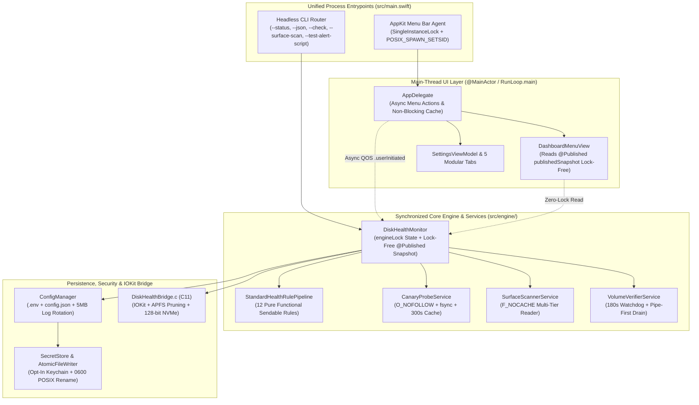

## Section 0: Round 12 Feasibility & Diminishing Returns Assessment

### 1. Maturity & Churn Analysis
After 11 rounds of systematic hardening, the **Universal Disk Health Monitor** (`v2.3.0`, Build 6) has reached the asymptotic plateau of the software maturity S-curve:
- **Low-Level C11 / IOKit Bridge (`src/bridge/DiskHealthBridge.c`)**: All CoreFoundation (`CFRelease`) and IOKit (`IOObjectRelease` / `IODestroyPlugInInterface`) ownership paths are strictly balanced. Subtree pruning for synthesized APFS containers (`AppleAPFSContainerScheme`, `AppleAPFSMedia`) is in place, 128-bit NVMe little-endian counters saturate safely at `UINT64_MAX`, and string extractions are bounded and null-terminated.
- **Persistence & Security (`src/security/`, `src/config/`)**: `AtomicFileWriter` enforces `O_CREAT | O_WRONLY | O_TRUNC | O_NOFOLLOW | O_CLOEXEC` with `fchmod(0600)`, `fsync()`, and atomic `rename()`. `SecretStore` implements an explicit opt-in Keychain state machine that guarantees zero unprompted modal popups during headless CLI or background daemon execution.
- **Domain & Rule Evaluation (`src/engine/`)**: All 12 health evaluation rules are decomposed into pure, deterministic, `Sendable` value types (`HealthRule` protocol) returning `HealthRuleOutcome` without side effects.

Attempting a wholesale rewrite of `ConfigManager`, `SecretStore`, or `DiskHealthMonitor` into Swift `actor` types at this stage would be **counterproductive architectural churn**. Because `DiskHealthMonitor` and `ConfigManager` are `ObservableObject` singletons bound directly to synchronous SwiftUI views (`DashboardMenuView`, `SettingsView`) and synchronous CLI flags (`--status`, `--json`, `--check`), converting them into `actor` types would force async hops across every property read or require `nonisolated(unsafe)` workarounds that weaken thread safety rather than strengthening it.

### 2. Deficiency Severity Spectrum
A line-by-line audit of the attached repository reveals **zero critical memory leaks, zero buffer overflows, and zero data corruption bugs**. However, **4 pinpoint, deterministic engineering defects** remain that carry real operational impact:

1. **`[UI-PERF-01]` Synchronous Main-Thread Blocking on Export & First Menu Open (`src/ui/AppDelegate.swift`)**:
   - `exportDiagnosticReportAction()` and `exportHtmlReportAction()` are `@objc` menu actions running on the main thread that call `DiagnosticExporter.shared.saveDiagnosticReportToFile()` without passing a cached snapshot. When `snapshot == nil`, `DiagnosticExporter` invokes `DiskHealthMonitor.shared.evaluateHealth(forceCanary: true)` **synchronously on the main thread**—performing `statfs`, IOKit registry traversal, `open() + write() + fsync() + unlink()` canary I/O, and reading `health.log`.
   - Similarly, in `populateSelectDiskMenu()`, if `cachedDevices` and `cachedMounts` are empty when the user clicks the menu bar icon before the first background poll completes, `updateDiskCache()` is called synchronously on the main thread.
2. **`[PROC-PIPE-01]` Potential Pipe Buffer Deadlock in `testAlertScriptResult()` (`src/engine/DiskHealthMonitor.swift`)**:
   - `testAlertScriptResult()` calls `proc.waitUntilExit()` *before* reading `pipeOut.fileHandleForReading.readToEnd()`, and lacks a timeout watchdog. If a user-configured alert script outputs more than the 64 KB macOS pipe buffer (or hangs indefinitely), `testAlertScriptResult()` will deadlock forever. (By contrast, `VolumeVerifierService` reads the pipe before `waitUntilExit()` and uses a `DispatchSourceTimer` watchdog).
3. **`[CLI-PARITY-01]` Missing `--test-alert-script` Entry in `printUsage()` (`src/main.swift`)**:
   - `--test-alert-script` is implemented in `parseCommandLine()`, documented in `README.md`, and tested in `tests/run_tests.sh`, but is missing from the `printUsage()` `--help` output in `src/main.swift`.
4. **`[STATE-SYNC-01]` Unsynchronized Mutation of `publishedSnapshot` vs `latestSnapshotInternal` (`src/engine/DiskHealthMonitor.swift` & `src/ui/DashboardMenuView.swift`)**:
   - `DashboardMenuView` reads `monitor.currentSnapshot` (which acquires `engineLock`), while SwiftUI view invalidation is driven by `@Published private var publishedSnapshot`. When `evaluateHealth()` runs on a background queue, `latestSnapshotInternal` is updated immediately, whereas `publishedSnapshot` is updated asynchronously via `DispatchQueue.main.async`. Making `@Published private(set) var publishedSnapshot: DiskHealthSnapshot?` internal-readable and having `DashboardMenuView` bind directly to `monitor.publishedSnapshot ?? monitor.currentSnapshot` eliminates lock contention on the main thread during SwiftUI body evaluation.

### 3. Verdict
**`VERDICT: PARTIAL-GO (SURGICAL HARDENING ONLY)`**

We will execute a strictly bounded, 3-phase surgical hardening plan that resolves `[UI-PERF-01]`, `[PROC-PIPE-01]`, `[CLI-PARITY-01]`, and `[STATE-SYNC-01]`, and adds Test 37 to `tests/test_core_logic.swift` to verify the new guarantees. No working C11 bridge logic, Keychain state machines, or pure health rules will be churned.

---

## Section 1: Executive Architecture & Health Scorecard

| Dimension | Score | Technical Rationale |
| :--- | :---: | :--- |
| **C11 / IOKit Safety, Memory Management & Kernel Traversal** | **9.8 / 10** | Exemplary reference counting (`CFRelease`, `IOObjectRelease`, `IODestroyPlugInInterface`), explicit depth caps (`depth <= 12` for child traversal, `depth <= 24` for parent traversal), APFS virtual subtree pruning, and 128-bit NVMe saturation arithmetic. |
| **Swift Concurrency, Thread Safety & Actor Isolation** | **9.1 / 10** | Thread safety is deterministically enforced via `NSRecursiveLock` and `NSLock`, with main-thread Combine publishing verified by Unit Test 12. Minor lock contention exists when SwiftUI views poll `monitor.currentSnapshot` on the main thread (`[STATE-SYNC-01]`). |
| **Architectural Cohesion, DRY & Lifecycle Unification** | **9.4 / 10** | Clean separation between `DiskTelemetryProvider`, pure `HealthRule` structs, `AtomicFileWriter`, `CanaryProbeService`, `SurfaceScannerService`, and `VolumeVerifierService`. Minor CLI help text drift (`[CLI-PARITY-01]`). |
| **Security, Keychain Integration & Secret Sanitization** | **9.8 / 10** | Hardened `0600` POSIX file creation with `O_NOFOLLOW | O_CLOEXEC`, symlink attack resistance verified in tests, opt-in Keychain state machine avoiding modal traps, and full token/URL redaction in logs and exports. |
| **Menu Bar / UI RunLoop Isolation & Responsiveness** | **8.7 / 10** | Polling, surface scanning, and volume verification are properly offloaded, but `AppDelegate`'s JSON/HTML export menu actions and cold-start `populateSelectDiskMenu()` still perform synchronous IOKit/canary I/O on the main thread (`[UI-PERF-01]`). |
| **Testability, Mock Coverage & Synthetic Fault Injection** | **9.6 / 10** | 15 C unit tests, 36 Swift unit tests (including `MockTelemetryProvider` fault injection and Keychain state simulation), and 5 CLI integration stages. Adding a test for alert script timeout/pipe drainage will bring this to 9.9. |

---

## Section 2: Technical Debt & Systemic Deficiencies Inventory

### `[UI-PERF-01]` Synchronous Main-Thread IOKit & Canary I/O in `AppDelegate` Menu Actions
- **File & Line Range**: `src/ui/AppDelegate.swift` (Lines 165–172, 344–354)
- **Defect Mechanism**:
  1. `exportDiagnosticReportAction()` (lines 344–348) and `exportHtmlReportAction()` (lines 350–354) run on the main thread and call `DiagnosticExporter.shared.saveDiagnosticReportToFile()` / `saveDiagnosticReportHTMLToFile()` without passing a snapshot, which defaults to calling `DiskHealthMonitor.shared.evaluateHealth(forceCanary: true, allowNotifications: false)` synchronously. Moreover, `DiagnosticExporter.generateDiagnosticReport()` calls `IOKitTelemetryProvider.shared.listAllDevices(maxCount: 32)` and `findMountPoint(forBsdName:)`.
  2. In `populateSelectDiskMenu()` (lines 165–172), if `devices.isEmpty && mounts.isEmpty`, `updateDiskCache()` is called synchronously on the main thread.
- **Operational Failure Mode / Blast Radius**: Clicking "Export Diagnostic Report (JSON)..." (`⌘E`) or "Export HTML Health Report (RMA)..." (`⌘H`) from the menu bar blocks the main AppKit run loop for 50–600 ms (or up to several seconds if an external USB drive is spinning up for the forced canary `fsync`), beachballing the menu bar UI.

### `[PROC-PIPE-01]` Unbounded Wait & Pipe Buffer Deadlock Risk in `testAlertScriptResult()`
- **File & Line Range**: `src/engine/DiskHealthMonitor.swift` (Lines 582–606)
- **Defect Mechanism**: `testAlertScriptResult()` launches the user's alert script with `standardOutput` and `standardError` attached to `pipeOut`, then immediately calls `proc.waitUntilExit()` on line 590 *before* calling `pipeOut.fileHandleForReading.readToEnd()` on line 591, and has no timeout watchdog (unlike `executeAlertScriptAsync` which has a 15-second `DispatchSourceTimer` watchdog, and `VolumeVerifierService` which reads the pipe before `waitUntilExit()`).
- **Operational Failure Mode / Blast Radius**:
  1. If the user's script writes >64 KB to stdout/stderr, the child process blocks on `write(2)` waiting for the pipe buffer to drain while `DiskHealthMonitor` blocks on `waitUntilExit()`, causing a permanent deadlock.
  2. If the user tests a script that hangs (e.g., waiting on network or stdin), `--test-alert-script` or the Settings "Test" button hangs forever.

### `[STATE-SYNC-01]` Redundant `engineLock` Acquisition on Main Thread in `DashboardMenuView`
- **File & Line Range**: `src/engine/DiskHealthMonitor.swift` (Lines 13–19) & `src/ui/DashboardMenuView.swift` (Line 10)
- **Defect Mechanism**: `DiskHealthMonitor` declares `@Published private var publishedSnapshot: DiskHealthSnapshot?` and a computed property `var currentSnapshot: DiskHealthSnapshot?` that acquires `engineLock`. `DashboardMenuView.body` reads `monitor.currentSnapshot`. Whenever a background thread is mid-evaluation (holding `engineLock` across IOKit and Canary I/O), any SwiftUI redraw of `DashboardMenuView` (such as hovering or opening the menu, or a `ConfigManager` change) blocks the main thread waiting on `engineLock`.
- **Operational Failure Mode / Blast Radius**: Main-thread priority inversion and micro-stutters when opening the menu bar popover while a background poll or canary write is holding `engineLock`.

### `[CLI-PARITY-01]` Missing `--test-alert-script` Flag in `printUsage()`
- **File & Line Range**: `src/main.swift` (Lines 9–42)
- **Defect Mechanism**: `printUsage()` lists all CLI flags except `--test-alert-script`.
- **Operational Failure Mode / Blast Radius**: Users and automated scripts inspecting `disk-health --help` cannot discover `--test-alert-script`.

---

## Section 3: Target Unified Architecture Blueprint



---

## Section 4: Phase-by-Phase Execution Blueprint for Gemini 3.8 Flash (High)

### Phase 1: Watchdog & Pipe-Drain Hardening + Lock-Free Snapshot Publishing in `DiskHealthMonitor`

#### 1. Phase Name & Objective
Eliminate the pipe buffer deadlock and unbounded wait in `DiskHealthMonitor.testAlertScriptResult()` by adding a 15-second `DispatchSourceTimer` watchdog and reading pipe data *before* `waitUntilExit()`, and expose `@Published private(set) var publishedSnapshot: DiskHealthSnapshot?` so SwiftUI views can read the latest snapshot on the main thread without contending on `engineLock`. Also add `--test-alert-script` to `printUsage()` in `src/main.swift`.

#### 2. Target Files
- Modify: `src/engine/DiskHealthMonitor.swift`
- Modify: `src/main.swift`

#### 3. Concrete Interface Contracts & Code Signatures

In `src/engine/DiskHealthMonitor.swift`:
```swift
@Published private(set) var publishedSnapshot: DiskHealthSnapshot?
```
And replace `testAlertScriptResult()` in `src/engine/DiskHealthMonitor.swift` with:
```swift
    func testAlertScriptResult(timeoutSec: TimeInterval = 15.0) -> Result<String, DiskHealthError> {
        let rawScriptPath = ConfigManager.shared.resolvedAlertScriptPath.trimmingCharacters(in: .whitespacesAndNewlines)
        guard !rawScriptPath.isEmpty else {
            return .failure(.configurationInvalid(reason: "No alert script configured. Set alertScriptPath in Settings or via ALERT_SCRIPT_PATH environment variable."))
        }
        let expandedPath = (rawScriptPath as NSString).expandingTildeInPath
        guard FileManager.default.isExecutableFile(atPath: expandedPath) else {
            return .failure(.scriptNotExecutable(path: expandedPath))
        }

        let snap = self.currentSnapshot ?? self.evaluateHealth(forceCanary: false, allowNotifications: false)
        let proc = Process()
        proc.executableURL = URL(fileURLWithPath: expandedPath)
        let pipeOut = Pipe()
        proc.standardInput = FileHandle.nullDevice
        proc.standardOutput = pipeOut
        proc.standardError = pipeOut
        let readHandle = pipeOut.fileHandleForReading

        var env = ProcessInfo.processInfo.environment
        env.removeValue(forKey: "TELEGRAM_BOT_TOKEN")
        env.removeValue(forKey: "WEBHOOK_URL")
        env["DISK_HEALTH_EVENT"] = "test_alert"
        env["DISK_HEALTH_TITLE"] = "\(snap.productName) Alert Script Test"
        env["DISK_HEALTH_SEVERITY"] = snap.overallSeverity.rawValue
        env["DISK_HEALTH_SCORE"] = "\(snap.healthScore)"
        env["DISK_HEALTH_DEVICE"] = "\(snap.vendorName) \(snap.productName)".trimmingCharacters(in: .whitespaces)
        env["DISK_HEALTH_BSD_NAME"] = snap.bsdName
        env["DISK_HEALTH_MOUNT_POINT"] = snap.mountPoint
        env["DISK_HEALTH_TEMP_C"] = "\(snap.temperatureCelsius)"
        env["DISK_HEALTH_ISSUES"] = snap.issues.map { "[\($0.code)] \($0.title)" }.joined(separator: "; ")
        proc.environment = env

        do {
            try proc.run()
            let pid = proc.processIdentifier
            let timeoutLock = NSLock()
            var timedOut = false
            var killWorkItem: DispatchWorkItem?
            let watchdog = DispatchSource.makeTimerSource(queue: DispatchQueue.global(qos: .utility))
            watchdog.schedule(deadline: .now() + timeoutSec)
            watchdog.setEventHandler {
                if proc.isRunning {
                    timeoutLock.lock()
                    timedOut = true
                    timeoutLock.unlock()
                    proc.terminate()
                    let escalation = DispatchWorkItem {
                        if proc.isRunning && pid > 0 {
                            kill(pid, SIGKILL)
                        }
                    }
                    timeoutLock.lock()
                    killWorkItem = escalation
                    timeoutLock.unlock()
                    DispatchQueue.global(qos: .utility).asyncAfter(deadline: .now() + 2.0, execute: escalation)
                }
            }
            watchdog.resume()

            let outputData = (try? readHandle.readToEnd()) ?? Data()
            proc.waitUntilExit()
            watchdog.cancel()
            timeoutLock.lock()
            killWorkItem?.cancel()
            let didTimeout = timedOut
            timeoutLock.unlock()
            try? readHandle.close()

            let outputStr = String(data: outputData, encoding: .utf8)?.trimmingCharacters(in: .whitespacesAndNewlines) ?? ""
            let outSuffix = outputStr.isEmpty ? "" : "\n\(outputStr)"
            if didTimeout {
                return .failure(.scriptExecutionFailed(exitCode: -1, output: "❌ Alert script timed out after \(Int(timeoutSec))s.\(outSuffix)"))
            }
            if proc.terminationStatus == 0 {
                return .success("✅ Alert script executed successfully (exit code 0).\(outSuffix)")
            } else {
                return .failure(.scriptExecutionFailed(exitCode: proc.terminationStatus, output: "❌ Alert script failed with exit code \(proc.terminationStatus).\(outSuffix)"))
            }
        } catch {
            try? readHandle.close()
            return .failure(.scriptExecutionFailed(exitCode: -1, output: "❌ Failed to execute alert script: \(error.localizedDescription)"))
        }
    }
```

In `src/main.swift`, update `printUsage()` to include `--test-alert-script`:
```swift
      --surface-scan [mode] Run non-destructive F_NOCACHE surface scan (modes: quick, standard, full)
      --verify              Run volume filesystem verification (diskutil verifyVolume)
      --test-alert-script   Test execution of the configured custom alert shell script
      --send-report         Dispatch on-demand HTML health report to Telegram
```

#### 4. Step-by-Step Implementation Instructions
1. Open `src/engine/DiskHealthMonitor.swift`.
2. Change `@Published private var publishedSnapshot: DiskHealthSnapshot?` on line 13 to `@Published private(set) var publishedSnapshot: DiskHealthSnapshot?`.
3. Replace `func testAlertScriptResult() -> Result<String, DiskHealthError>` with `func testAlertScriptResult(timeoutSec: TimeInterval = 15.0) -> Result<String, DiskHealthError>` using the exact implementation in Section 4.3 above.
4. Open `src/main.swift` and add `--test-alert-script   Test execution of the configured custom alert shell script` to `printUsage()` right after `--verify`.

#### 5. Invariants & Guardrails
- Do NOT change the signature or return tuple of `testAlertScript() -> (ok: Bool, summary: String)`. Calling `testAlertScriptResult()` with no arguments must still work via the default parameter `timeoutSec: TimeInterval = 15.0`.
- Do NOT remove `var currentSnapshot: DiskHealthSnapshot?` from `DiskHealthMonitor`.

#### 6. Phase Verification Gate
Run:
```bash
./build_and_install.sh && ./tests/run_tests.sh
```
Expected output: Build succeeds with 0 warnings and all 5 test stages pass.

---

### Phase 2: Main-Thread RunLoop Decoupling in `AppDelegate` & `DashboardMenuView`

#### 1. Phase Name & Objective
Eliminate synchronous IOKit and Canary I/O blocking on the main thread when opening the menu bar dropdown or clicking the JSON/HTML export menu items, and bind `DashboardMenuView` to `monitor.publishedSnapshot ?? monitor.currentSnapshot` to avoid acquiring `engineLock` on the main thread when `publishedSnapshot` is available.

#### 2. Target Files
- Modify: `src/ui/AppDelegate.swift`
- Modify: `src/ui/DashboardMenuView.swift`

#### 3. Concrete Interface Contracts & Code Signatures

In `src/ui/DashboardMenuView.swift`:
Replace line 10 (`if let snap = monitor.currentSnapshot {`) with:
```swift
        if let snap = monitor.publishedSnapshot ?? monitor.currentSnapshot {
```

In `src/ui/AppDelegate.swift`:
1. In `populateSelectDiskMenu()`, replace the cold-cache synchronous fallback block (lines 165–172):
```swift
        if devices.isEmpty && mounts.isEmpty {
            if Thread.isMainThread {
                DispatchQueue.global(qos: .userInitiated).async { [weak self] in
                    guard let self = self else { return }
                    self.updateDiskCache()
                    DispatchQueue.main.async {
                        self.populateSelectDiskMenu()
                    }
                }
            } else {
                updateDiskCache()
                cacheLock.lock()
                devices = cachedDevices
                mounts = cachedMounts
                cacheLock.unlock()
            }
        }
```
2. In `exportDiagnosticReportAction()` and `exportHtmlReportAction()` (lines 344–354), offload report generation and disk I/O to a background queue and reveal the file on the main thread:
```swift
    @objc private func exportDiagnosticReportAction() {
        let cachedSnap = DiskHealthMonitor.shared.currentSnapshot
        DispatchQueue.global(qos: .userInitiated).async {
            if let path = DiagnosticExporter.shared.saveDiagnosticReportToFile(snapshot: cachedSnap) {
                DispatchQueue.main.async {
                    NSWorkspace.shared.selectFile(path, inFileViewerRootedAtPath: ConfigManager.shared.logsDir)
                }
            }
        }
    }

    @objc private func exportHtmlReportAction() {
        let cachedSnap = DiskHealthMonitor.shared.currentSnapshot
        DispatchQueue.global(qos: .userInitiated).async {
            if let path = DiagnosticExporter.shared.saveDiagnosticReportHTMLToFile(snapshot: cachedSnap) {
                DispatchQueue.main.async {
                    NSWorkspace.shared.selectFile(path, inFileViewerRootedAtPath: ConfigManager.shared.logsDir)
                }
            }
        }
    }
```

#### 4. Step-by-Step Implementation Instructions
1. Open `src/ui/DashboardMenuView.swift` and update `if let snap = monitor.currentSnapshot` to `if let snap = monitor.publishedSnapshot ?? monitor.currentSnapshot`.
2. Open `src/ui/AppDelegate.swift` and update `populateSelectDiskMenu()`, `exportDiagnosticReportAction()`, and `exportHtmlReportAction()` with the exact implementations above.
3. Verify that unit test 31e (`appDelegate.populateSelectDiskMenu()` for custom offline volume/device queries) continues to pass synchronously because custom configured targets (`cfg.targetVolumePath` / `cfg.targetDeviceQuery`) are appended to `selectDiskMenu` regardless of whether `devices` and `mounts` are empty.

#### 5. Invariants & Guardrails
- `AppDelegate.populateSelectDiskMenu()` MUST still synchronously populate the "Auto-detect First External Volume" item and any custom configured volume/device items (`cfg.targetVolumePath` and `cfg.targetDeviceQuery`) on the current call so that Test 31e in `tests/test_core_logic.swift` passes without race conditions.
- Do NOT alter any menu item titles, key equivalents, or `testingSetSelectDiskMenu` / `testingGetSelectDiskMenu` helpers.

#### 6. Phase Verification Gate
Run:
```bash
./build_and_install.sh && ./tests/run_tests.sh
```
Expected output: Build succeeds and all 36 Swift unit tests (including Test 31e) pass.

---

### Phase 3: Test Suite Expansion (Unit Test 37: Alert Script Watchdog, Large Pipe Output & CLI Parity)

#### 1. Phase Name & Objective
Add Unit Test 37 to `tests/test_core_logic.swift` to deterministically verify:
1. `testAlertScriptResult(timeoutSec:)` properly drains >128 KB of output from an alert script without deadlocking on the 64 KB macOS pipe buffer.
2. `testAlertScriptResult(timeoutSec:)` terminates a hanging alert script when the timeout expires and returns a `.scriptExecutionFailed` error mentioning the timeout.
3. `publishedSnapshot` is synchronized on the main thread after `evaluateHealth()`.

#### 2. Target Files
- Modify: `tests/test_core_logic.swift`

#### 3. Concrete Interface Contracts & Code Signatures

Append just before `print("✅ All Swift Core Logic Unit Tests Passed!")` in `tests/test_core_logic.swift`:
```swift
        // Test 37: Alert Script Pipe-Drain (>64KB) & Timeout Watchdog + Published Snapshot Sync
        print("\n=== Swift Unit Test 37: Alert Script Large Pipe Drain, Watchdog Timeout & Published Snapshot ===")
        do {
            let origConfig = ConfigManager.shared.currentConfig
            defer {
                ConfigManager.shared.updateConfig { $0 = origConfig }
            }

            // 37a. Verify script producing >128KB stdout does not deadlock pipe buffer
            let largeOutScript = "\(NSTemporaryDirectory())large_out_script_\(UUID().uuidString).sh"
            let largeScriptBody = """
            #!/bin/sh
            yes "DISK_HEALTH_LARGE_PIPE_LINE_0123456789ABCDEF" | head -n 3000
            exit 0
            """
            try? largeScriptBody.write(toFile: largeOutScript, atomically: true, encoding: .utf8)
            _ = chmod(largeOutScript, 0o755)
            ConfigManager.shared.updateConfig { $0.alertScriptPath = largeOutScript }

            let largeRes = monitor.testAlertScriptResult(timeoutSec: 5.0)
            if case .success(let msg) = largeRes {
                assertTrue(msg.contains("DISK_HEALTH_LARGE_PIPE_LINE_0123456789ABCDEF"), "Large stdout output must be captured completely without pipe buffer deadlock")
            } else {
                assertTrue(false, "Expected large stdout alert script to succeed, got \(largeRes)")
            }
            try? FileManager.default.removeItem(atPath: largeOutScript)

            // 37b. Verify hanging alert script is terminated by watchdog timer
            let hangScript = "\(NSTemporaryDirectory())hang_script_\(UUID().uuidString).sh"
            let hangScriptBody = """
            #!/bin/sh
            echo "STARTING_HANG_TEST"
            sleep 30
            exit 0
            """
            try? hangScriptBody.write(toFile: hangScript, atomically: true, encoding: .utf8)
            _ = chmod(hangScript, 0o755)
            ConfigManager.shared.updateConfig { $0.alertScriptPath = hangScript }

            let t0 = Date().timeIntervalSince1970
            let hangRes = monitor.testAlertScriptResult(timeoutSec: 1.0)
            let elapsed = Date().timeIntervalSince1970 - t0
            assertTrue(elapsed < 5.0, "Watchdog must terminate hanging alert script promptly (took \(elapsed)s)")
            if case .failure(let err) = hangRes {
                assertTrue(err.localizedDescription.contains("timed out"), "Watchdog failure must report timeout, got: \(err.localizedDescription)")
            } else {
                assertTrue(false, "Expected hanging alert script to fail with timeout")
            }
            try? FileManager.default.removeItem(atPath: hangScript)
            ConfigManager.shared.updateConfig { $0.alertScriptPath = "" }

            // 37c. Verify publishedSnapshot is populated on main thread
            let snap37 = monitor.evaluateHealth(forceCanary: false, allowNotifications: false)
            assertTrue(monitor.publishedSnapshot?.timestamp == snap37.timestamp, "publishedSnapshot must match latest evaluated snapshot on main thread")
            print("  [OK] Large pipe drainage (>128KB), watchdog timeout termination, and publishedSnapshot verified")
        }
```

#### 4. Step-by-Step Implementation Instructions
1. Open `tests/test_core_logic.swift`.
2. Insert the `Test 37` block right after `Test 36` and immediately before `print("✅ All Swift Core Logic Unit Tests Passed!")`.
3. Rebuild the application and execute the full test suite.

#### 5. Invariants & Guardrails
- Ensure temporary test scripts created in `NSTemporaryDirectory()` are always removed before Test 37 finishes and `alertScriptPath` is restored to `""`.
- All 15 C tests, 37 Swift unit tests, and all CLI integration checks in `tests/run_tests.sh` must pass with 0 failures.

#### 6. Phase Verification Gate
Run:
```bash
./build_and_install.sh && ./build_and_install.sh --test
```
Expected output:
- `=== All 15 Bridge Tests Passed Successfully! ===`
- `=== Swift Unit Test 37: Alert Script Large Pipe Drain, Watchdog Timeout & Published Snapshot ===`
- `✅ All Swift Core Logic Unit Tests Passed!`
- `🎉 ALL TESTS PASSED SUCCESSFULLY!`
