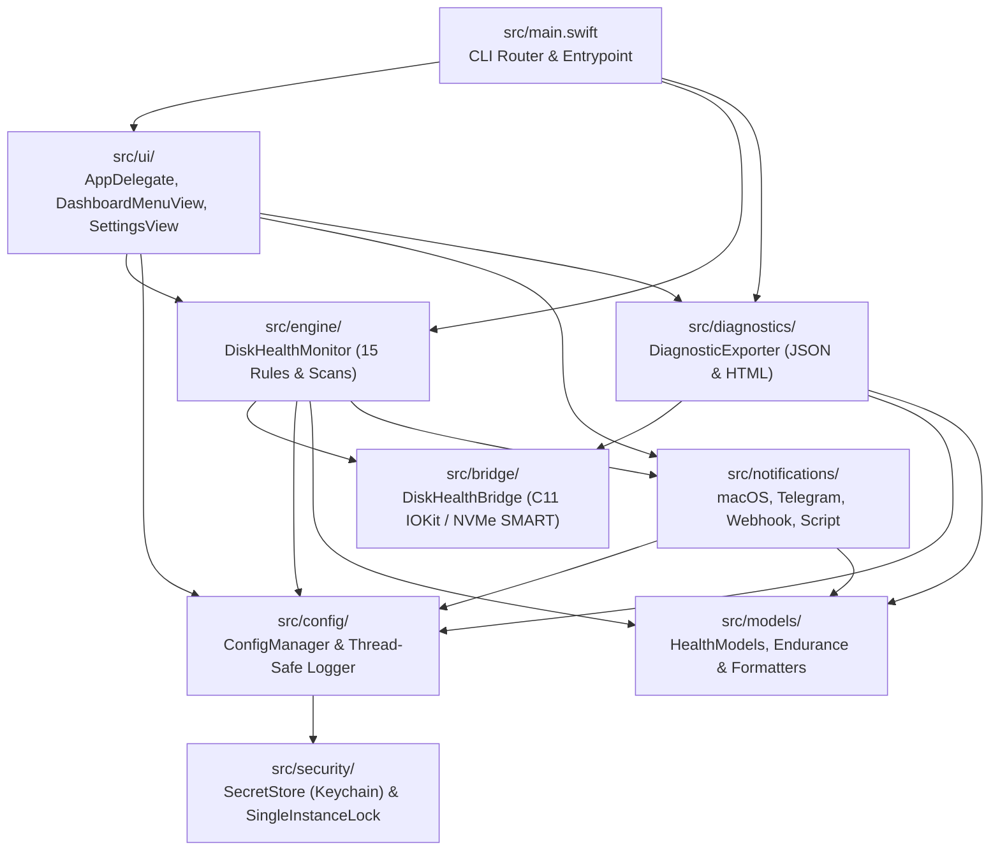

# Source Code Architecture (`src/`)

This directory contains the source tree for **Universal Disk Health Monitor**, implemented as a hybrid **C11 + Swift 5** application. Low-level hardware IOKit and NVMe S.M.A.R.T. operations are implemented in C11 (`src/bridge/`), while domain modeling, health evaluation, security, notification dispatch, and the user interface are built in Swift.

---

## Architecture Diagram

---

## Submodule Directory Map

| Directory | Primary Files | Scope & Responsibilities |
| :--- | :--- | :--- |
| [`main.swift`](main.swift) | `main.swift` | CLI flag routing, argument parsing, headless command execution, and `NSApplication` launch |
| [`bridge/`](bridge/README.md) | `DiskHealthBridge.h`, `DiskHealthBridge.c`, `DiskProcessBridge.c`, `DiskPowerHidBridge.c` | Low-level C11 IOKit registry traversal, APFS container resolution, 128-bit NVMe SMART, `<libproc.h>` blockers, and Dark Wake / HID thermal bridges |
| [`models/`](models/README.md) | `HealthModels.swift`, `AutomationModels.swift`, `DiskHealthError.swift` | `Codable` domain models (`DiskHealthSnapshot`, `MultiDiskHealthSnapshot`), automation schemas (`ActionRule`), endurance projections, synchronized formatters |
| [`security/`](security/README.md) | `SubprocessRunner.swift`, `SecretStore.swift`, `SingleInstanceLock.swift` | PGID-isolated `posix_spawn` runner, macOS Keychain (`Security.framework`) storage, `AtomicFileWriter` (`0600`), POSIX `flock` lock |
| [`config/`](config/README.md) | `ConfigManager.swift` | Multi-source configuration resolution (`applyKeyValueMap`), `.env` parser, secret redaction, rotating 5 MB file logger |
| [`notifications/`](notifications/README.md) | `AlertCoordinator.swift`, `MacOSNotifier.swift`, `TelegramNotifier.swift`, `WebhookNotifier.swift` | Alert hysteresis/cooldowns, Notification Center alerts, Telegram Bot client, universal webhooks, and shell script hooks |
| [`network/`](network/OpenMetricsServer.swift) | `OpenMetricsServer.swift` | Loopback `NWListener` HTTP server (`127.0.0.1:9102`) exposing `/metrics`, `/status.json`, and `/healthz` |
| [`diagnostics/`](diagnostics/README.md) | `DiagnosticExporter.swift`, `OpenFileBlockerInspector.swift`, `ProcessIoInspector.swift` | Sanitized JSON/HTML RMA reports, open file blocker inspector, and `<libproc.h>` runaway I/O throttler |
| [`engine/`](engine/README.md) | `DiskHealthMonitor.swift`, `PersistentStateStore.swift`, `ParallelDriveProber.swift`, `HealthRules.swift`, `ActionRuleEngine.swift`, `TelemetryProvider.swift`, `TelemetryHistoryStore.swift`, `PowerManagementService.swift`, `ApfsSnapshotService.swift`, `CanaryProbeService.swift`, `SurfaceScannerService.swift`, `VolumeVerifierService.swift` | Lock-split 15-rule evaluation engine, 4-worker parallel prober, automation rules, 90d telemetry archive, power management, canary probe, surface scanner, volume verification |
| [`ui/`](ui/README.md) | `AppDelegate.swift`, `DashboardMenuView.swift`, `SettingsView.swift`, `SettingsViewModel.swift`, `SettingsComponents.swift`, `tabs/*.swift` | Menu bar `NSStatusItem`, live dashboard card, shared components, and 7-tab Settings window (`⌘,`, `⌘I`, `⌘S`, `⌘A`) |

---

## Compilation Pipeline

The build script compiles every C translation unit in `src/bridge/*.c` into optimized object files (`.build-cache/*_<arch>.o`) using `clang` (`-std=c11 -O2 -Wall -Wextra`), then compiles all Swift sources in `src/` as a unified module (`-O -whole-module-optimization`) linking against those bridge objects and native Apple frameworks (`Cocoa`, `SwiftUI`, `IOKit`, `DiskArbitration`, `Network`, `Security`, `UserNotifications`, `UniformTypeIdentifiers`).
