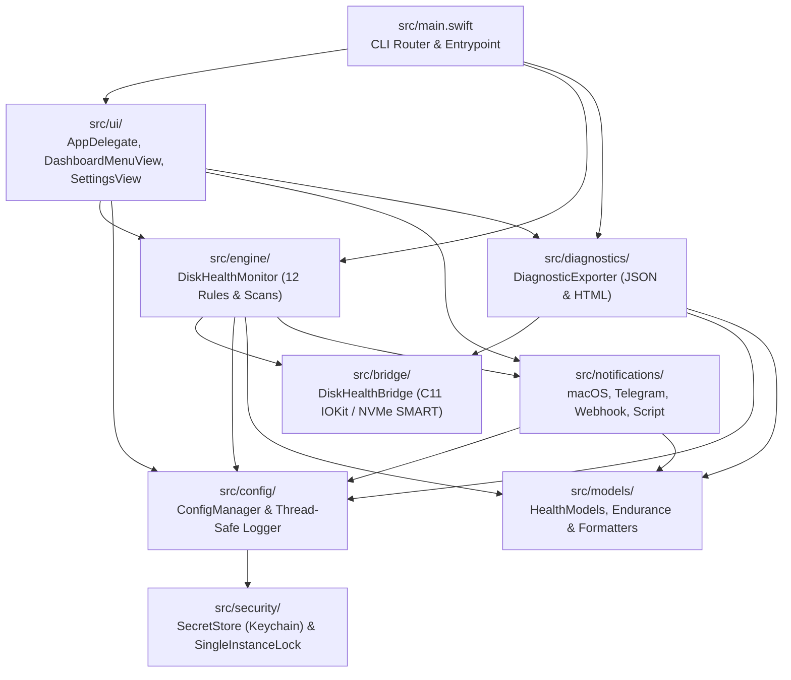

# Source Code Architecture (`src/`)

This directory contains the source tree for **Universal Disk Health Monitor**, implemented as a hybrid **C11 + Swift 5** application. Low-level hardware IOKit and NVMe S.M.A.R.T. operations are implemented in C11 (`src/bridge/`), while domain modeling, health evaluation, security, notification dispatch, and the user interface are built in Swift.

---

## Architecture Diagram

---

## Submodule Directory Map

| Directory | Primary Files | Scope & Responsibilities |
| :--- | :--- | :--- |
| [`main.swift`](main.swift) | `main.swift` | CLI flag routing, argument parsing, headless command execution, and `NSApplication` launch |
| [`bridge/`](bridge/README.md) | `DiskHealthBridge.h`, `DiskHealthBridge.c` | Low-level C11 IOKit registry traversal, APFS container physical store resolution, 128-bit NVMe SMART queries |
| [`models/`](models/README.md) | `HealthModels.swift` | `Codable` domain models (`DiskHealthSnapshot`), SSD wear/endurance forecasting, synchronized formatters |
| [`security/`](security/README.md) | `SecretStore.swift`, `SingleInstanceLock.swift` | macOS Keychain (`Security.framework`) storage, restricted `0600` fallback, POSIX single-instance lock |
| [`config/`](config/README.md) | `ConfigManager.swift` | Multi-source configuration resolution (`.env`, `config.json`), secret redaction, thread-safe file logger |
| [`notifications/`](notifications/README.md) | `MacOSNotifier.swift`, `TelegramNotifier.swift`, `WebhookNotifier.swift` | Native Notification Center alerts, Telegram Bot client, universal webhooks, and shell script hooks |
| [`diagnostics/`](diagnostics/README.md) | `DiagnosticExporter.swift` | Sanitized JSON diagnostic exporter and standalone responsive HTML RMA report generator |
| [`engine/`](engine/README.md) | `DiskHealthMonitor.swift` | 12-rule evaluation engine, canary I/O probe, multi-tier surface scanner, scheduled volume verification |
| [`ui/`](ui/README.md) | `AppDelegate.swift`, `DashboardMenuView.swift`, `SettingsView.swift` | Menu bar `NSStatusItem`, live dashboard card, and 5-tab Settings window (`⌘,`) |

---

## Compilation Pipeline

The build script compiles `src/bridge/DiskHealthBridge.c` into an optimized object file (`build/DiskHealthBridge.o`) using `clang` (`-std=c11 -O2`), then compiles all Swift sources in `src/` as a unified module linking against `DiskHealthBridge.o` and system frameworks (`Cocoa`, `SwiftUI`, `IOKit`, `DiskArbitration`, `Security`, `UserNotifications`).
