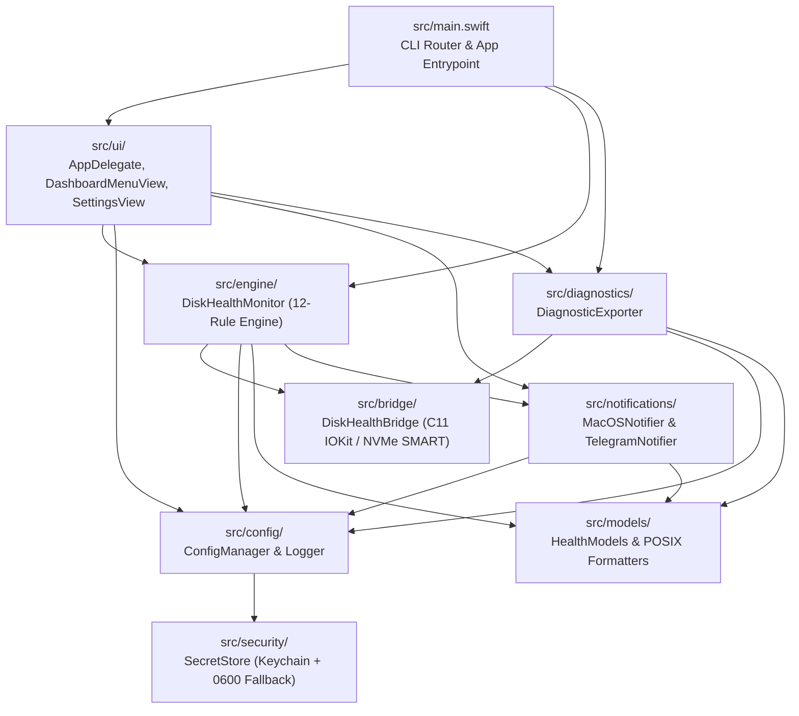

# Source Code Overview (`src/`)

This directory contains the complete source code for **Universal Disk Health Monitor**, organized into focused architectural layers. The application uses a hybrid **C11 + Swift 5** compilation model: hardware-level IOKit and NVMe SMART operations are implemented in C11 (`src/bridge/`), while domain modeling, configuration, security, notifications, health evaluation, and the SwiftUI/AppKit user interface are written in Swift.

---

## Module Architecture

---

## Directory & File Breakdown

### 1. Entrypoint
- **[`main.swift`](main.swift)**:
  - Parses command-line flags (`--status`, `--json`, `--list-disks`, `--check`, `--watch-mounts`, `--deep`, `--volume`, `--device`, `--export-config`, `--export-diagnostics`, `--menubar`, `--help`).
  - Routes headless CLI invocations directly to `DiskHealthMonitor` or `DiagnosticExporter` and exits with an appropriate POSIX status code (`0` for healthy/warning, `2` for critical).
  - Bootstraps `NSApplication` with `AppDelegate` when launched as a menu bar app (`--menubar` or no CLI action flags).

### 2. Submodules

| Subfolder | Documentation | Files | Responsibility |
| :--- | :--- | :--- | :--- |
| [`bridge/`](bridge/README.md) | [bridge/README.md](bridge/README.md) | `DiskHealthBridge.h`, `DiskHealthBridge.c` | Low-level C11 bridge querying `IOKit`, `DiskArbitration`, `statfs`, and `IONVMeSMARTUserClient` |
| [`models/`](models/README.md) | [models/README.md](models/README.md) | `HealthModels.swift` | `Codable` domain models (`DiskHealthSnapshot`, `HealthSeverity`, `HealthIssue`, `DiskPersistentState`) and `en_US_POSIX` date formatters |
| [`security/`](security/README.md) | [security/README.md](security/README.md) | `SecretStore.swift` | macOS Keychain (`Security.framework`) wrapper with `0600` JSON file fallback for headless environments |
| [`config/`](config/README.md) | [config/README.md](config/README.md) | `ConfigManager.swift` | Multi-layered configuration loader/writer, `.env` parser, secret redaction, and structured `health.log` writer |
| [`notifications/`](notifications/README.md) | [notifications/README.md](notifications/README.md) | `MacOSNotifier.swift`, `TelegramNotifier.swift` | Native macOS Notification Center alerts and asynchronous Telegram Bot HTML notifications |
| [`diagnostics/`](diagnostics/README.md) | [diagnostics/README.md](diagnostics/README.md) | `DiagnosticExporter.swift` | Generates sanitized, self-contained JSON diagnostic bundles for debugging |
| [`engine/`](engine/README.md) | [engine/README.md](engine/README.md) | `DiskHealthMonitor.swift` | Orchestrates hardware telemetry collection, active `.disk_health_canary` probes, `diskutil verifyVolume`, 12 health rules, and alert cooldowns |
| [`ui/`](ui/README.md) | [ui/README.md](ui/README.md) | `AppDelegate.swift`, `DashboardMenuView.swift`, `SettingsView.swift` | AppKit `NSStatusItem` menu bar controller, live SwiftUI telemetry card, and 4-tab `Cmd+,` Settings window |

---

## Compilation Model

All `.swift` files in `src/` are compiled together into a single Swift module (`DiskHealthMonitor`) by `swiftc`, bridging C types and functions declared in `src/bridge/DiskHealthBridge.h` via `-import-objc-header src/bridge/DiskHealthBridge.h`. This eliminates the need for an Xcode `.xcodeproj` or Swift Package Manager wrapper while maintaining clean file and directory separation.
